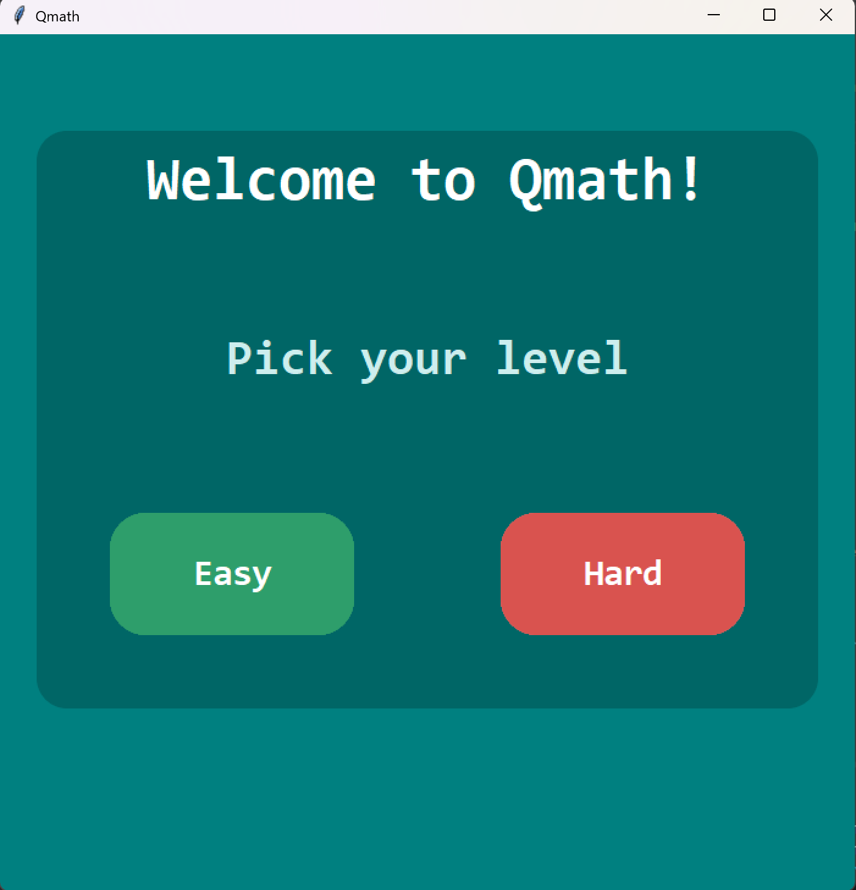

# QMath

A simple math quiz game built with Python and Tkinter. Pick a level, choose an operation, and test your skills.



## Features

- **Two levels:** Easy and Hard
- **Easy operations:** Addition, Subtraction, Multiplication, Division
- **Hard operations:** BODMAS and Algebra
- **Randomly generated questions** for each operation, with no end, so you can keep practising
- **Instant feedback:** tells you if you're correct or wrong, and shows the right answer when you miss
- **Live score** (correct / attempted) for each practice session
- **Whole-number answers only**, so there are no remainders or decimals to worry about
- **Keyboard friendly:** press Enter to submit and again to move to the next question
- **Input checking:** typing something that isn't a number gives a message and doesn't count against your score
- **Clean, modern interface** with rounded buttons and hover effects, built with CustomTkinter
- **Simple navigation** with Back buttons between screens

## Example Questions

| Operation | Example |
| --------- | ------- |
| Addition / Subtraction | `23 + 41 = ?` |
| Multiplication / Division | `56 ÷ 7 = ?` |
| BODMAS | `(8 + 5) × 3` |
| Algebra | `3x + 4 = 19` |

## Built With

- Python 3
- Tkinter
- [CustomTkinter](https://github.com/TomSchimansky/CustomTkinter)

## Getting Started

### Requirements

- Python 3.10 or newer

### Installation

1. Clone the repository:
   ```
   git clone https://github.com/YOUR-USERNAME/QMath.git
   cd QMath
   ```

2. Create and activate a virtual environment:
   ```
   python -m venv .venv
   .venv\Scripts\activate
   ```
   On Mac/Linux, use `source .venv/bin/activate` instead.

3. Install the dependencies:
   ```
   pip install customtkinter
   ```

4. Run the game:
   ```
   python main.py
   ```

## Project Structure

```
QMath/
├── main.py         # Creates the window and switches between screens
├── screens.py      # The menu, operation and quiz screens (easy and hard)
├── questions.py    # Generates the questions and answers (no GUI code)
├── theme.py        # Colours and fonts used across the app
└── EXPLANATION.md  # Detailed walkthrough of each class
```

## How to Play

1. Choose **Easy** or **Hard** on the home screen.
2. Pick the operation you want to practise.
3. Type your answer in the box and press **Submit** (or Enter).
4. You'll see whether you were right or wrong. Press **Next** (or Enter) for a new question.
5. Use **Back** to return and try a different operation or level.

For algebra questions, type the value of `x`. Typing `4` or `x=4` both work.

## How It Works

The question logic is kept separate from the interface. `questions.py` builds each
question backwards from its answer (for example, it picks the answer and divisor first,
then works out the number to divide), which guarantees every answer is a whole number.
`screens.py` has one shared quiz page that the easy and hard pages both inherit from,
so each level only sets its own colours.

## Author

**Jennifer Nggada**
